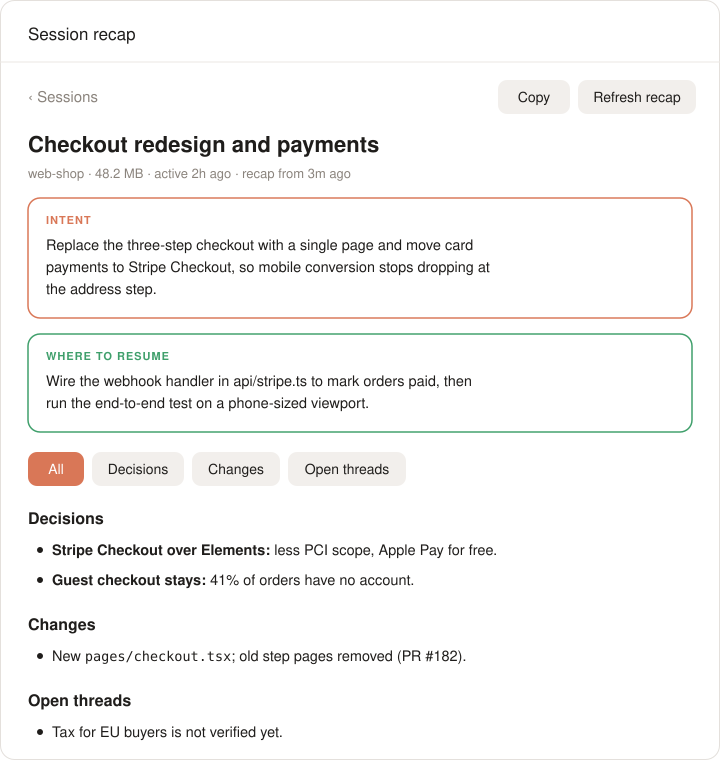

# session-recap

<p align="center"><a href="./README.md">English</a> | <a href="./README.zh-CN.md">中文</a></p>

<p align="center">

</p>

<p align="center"><strong>Remember what every AI coding session was for.</strong></p>

<p align="center"><sub>intent · key decisions · what changed · open threads · where to resume, for sessions of any length, from any agent, through MCP, a local viewer or a plugin</sub></p>

<p align="center">
<a href="https://github.com/BruceXcluding/session-recap/actions/workflows/ci.yml"></a>
<a href="https://github.com/BruceXcluding/session-recap/releases"></a>
<a href="https://www.npmjs.com/package/session-recap"></a>
<a href="./LICENSE"></a>
</p>

<p align="center">
<a href="https://claude.com/product/claude-code" title="Claude Code"></a>&nbsp;
<a href="https://github.com/openai/codex" title="Codex"><picture><source media="(prefers-color-scheme: dark)" srcset="https://api.iconify.design/simple-icons/openai.svg?color=white"></picture></a>&nbsp;
<a href="https://www.deepseek.com" title="deepseek-harness (dsh)"></a>&nbsp;
<a href="https://opencode.ai" title="OpenCode"><picture><source media="(prefers-color-scheme: dark)" srcset="https://cdn.simpleicons.org/opencode/FFFFFF"></picture></a>
</p>

---

Projects grow, and so does the number of sessions in each one, often across several agents. After a few weeks a session is a 100 MB transcript you no longer remember: why you started it, what you decided, what was left half done.

**session-recap** reads a session's whole transcript and writes a short, structured recap. Use it from **any MCP client** (Codex, Cursor, Zed, Cline, Gemini CLI, OpenCode, Claude Code…), in a **local viewer** for every agent's sessions, from the **command line**, or through native plugins for **Claude Code**, **dsh** and **Codex**.

<p align="center">

</p>

| Section | What it answers |
| --- | --- |
| **Intent** | What was I ultimately trying to achieve? |
| **Key ideas and decisions** | What did we choose, and why? Which alternatives were rejected? |
| **What changed** | Files, features, documents, commits, PRs |
| **Open threads** | What is unfinished, unverified or still a question |
| **Where to resume** | The most sensible next step today |

Every recap also has a **Map**: the phases the work went through (pivots marked) down to "you are here", the key decisions with what was turned down, and lists of what shipped, what is open and what was dropped. Recaps are written in the language you mostly write in.

## Quick start

```bash
npm install -g session-recap
session-recap mcp-config            # prints the MCP entry for your client
session-recap serve                 # opens the local viewer
```

Then, in your agent: *"Recap this session"*, *"What was my last session in this project about?"*, *"总结一下这个会话"*.

**No API key needed.** Through MCP, the agent you are talking to writes the recap with its own model; session-recap only reads and condenses the transcript. A model of session-recap's own is optional (for the CLI and the viewer's **Write recap** button).

Or run it without installing: `npx session-recap …`. session-recap has no dependencies and runs no install scripts. The development version: `npm install -g github:BruceXcluding/session-recap --allow-git=all` (npm 12 blocks installs from GitHub without the flag).

**Requirements:** Node.js 20+, `python3` (macOS ships one), and for dsh sessions the `zstd` command or Python 3.14+.

## Ways to use it

| | Best for | How |
| --- | --- | --- |
| **MCP server** | any MCP client | `session-recap mcp-config <client>`, see below |
| **Local viewer** | browsing every agent's sessions, Recap and Map | `session-recap serve` |
| **Claude Code plugin** | a Recap / Map pane beside the chat | `/plugin install session-recap --marketplace BruceXcluding/session-recap` |
| **dsh plugin** | `/recap` and the `session_recap` tool in dsh | [packages/dsh](packages/dsh/README.md) |
| **Codex plugin** | the MCP server, packaged for Codex | [plugins/codex](plugins/codex/README.md) |
| **Command line** | scripts, quick looks, other formats | `session-recap`, `session-recap list` |

### MCP server

`session-recap mcp-config <client>` prints the entry for `claude`, `codex`, `cursor`, `gemini` (and Qwen Code), `opencode`, `zed`, `vscode` or `cline`, with absolute paths so an IDE started from the dock finds it. For example:

```bash
session-recap mcp-config codex >> ~/.codex/config.toml
claude mcp add --scope user session-recap -- session-recap mcp
```

Tools:

| Tool | What it does |
| --- | --- |
| `list_sessions` | Sessions of every agent, filtered by title words, project folder or agent |
| `recap_session` | The recap of the current session (or one named): a stored one if the session has not changed; else written by session-recap's model if one is configured; else the condensed, secret-free transcript and instructions for the calling agent to write it |
| `save_recap` | Stores the recap the agent wrote, so it is reused, and updated from the new part next time |

`recap_session` also takes `format`: `standup`, `handoff` or `pr` instead of the recap.

### Local viewer

`session-recap serve` opens `http://127.0.0.1:4711` with every agent's sessions by project folder, grouped by time, filtered by agent; each session's Recap and Map; and, with a model configured, **Write recap** and **Update recap**. It reads the recaps written by the Claude Code plugin, the CLI and MCP clients alike. It answers only on loopback, to the browser tab it opened.

### Claude Code plugin

`/session-recap` recaps the session you are in; `/session-recap browse` lists projects and sessions; `/session-recap <name>` opens a project or a session by name. The pane shows Recap and Map, uses the session's own model (or one picked under **Model**), and shows your Claude Code sessions first, with **All agents** one tap away.

### Command line

| Command | What it does |
| --- | --- |
| `session-recap [words]` | Recaps the session whose title holds the words; with none, the newest one in this folder |
| `session-recap list [words]` | Lists sessions (the calling agent's; `--all` for every agent) |
| `session-recap --format standup` | A standup note instead (`handoff`, `pr`) |
| `session-recap --dry-run` | Shows the size that would be sent, and how many secrets were removed, without calling a model |
| `session-recap models` | Lists your provider's models |
| `session-recap config set model <id>` | Saves settings (`partModel`, `api`, `baseUrl`; the key with `config set apiKey -` from stdin) |

The CLI's own model: `SESSION_RECAP_API` (`anthropic` or `openai`), `SESSION_RECAP_BASE_URL`, `SESSION_RECAP_API_KEY`, `SESSION_RECAP_MODEL`, or `ANTHROPIC_*`, `DEEPSEEK_API_KEY`, `OPENAI_API_KEY`.

## Supported agents

| Agent | Sessions read from |
| --- | --- |
| Claude Code | `~/.claude/projects/` |
| Codex | `~/.codex/sessions/`, `archived_sessions/` (review threads left out) |
| dsh (deepseek-harness) | `~/.dsh/sessions/` (zstd; subagent sessions left out) |
| OpenCode | `~/.local/share/opencode/opencode.db` |

Want another? [Adding an agent](docs/adding-an-agent.md) is one reader and one test, or [ask for it](https://github.com/BruceXcluding/session-recap/issues/new?template=new_agent.yml).

## Privacy

- **Local.** Sessions are read on your machine. Text leaves it only in the model call a recap needs: your agent's (MCP, plugins) or the one you configured (CLI, viewer). No telemetry.
- **Secrets removed first.** Keys, tokens, private keys, credentials in URLs and `PASSWORD=…`-style assignments are replaced with `[REDACTED:<kind>]` before any text reaches a model. `--dry-run` shows how many. It is pattern matching, so it cannot know every format: see [SECURITY.md](SECURITY.md).
- **What is sent** is a condensed transcript: your prompts, each turn's final reply, commits and PRs, the files edited. Tool output and intermediate replies are left out.

## Token use

Listing never calls a model. On a real 179 MB Claude Code session (220 prompts), a first recap sends about **195k characters (~96k tokens)**; when the session continues, an update reads only the new prompts. Long sessions are condensed in parts of ≤75k characters, each part's notes cached, and a cheaper model can condense the parts (`partModel`).

## How it works

```
saved sessions (Claude Code · Codex · dsh · OpenCode)
        │
hooks/digest.py      one reader per agent → turns (prompt, actions, final reply, edits) → secrets removed
        │
core/recap.mjs       parts → notes (parallel, cached) → one call writes the recap and its map, or updates it
        │
MCP server · viewer · CLI · Claude Code pane · dsh tool and /recap      (one cache: ~/.cache/session-recap)
```

Output is versioned: see [docs/data-format.md](docs/data-format.md) and [`schema/recap-v1.schema.json`](schema/recap-v1.schema.json) to build your own viewer or exporter.

## Contributing

Agents, recap formats, translations and viewers are all welcome. Start with [CONTRIBUTING.md](CONTRIBUTING.md); [adding an agent](docs/adding-an-agent.md) and adding a format (one entry in [`core/formats.mjs`](core/formats.mjs)) are the easiest first contributions.

## License

[MIT](./LICENSE)
