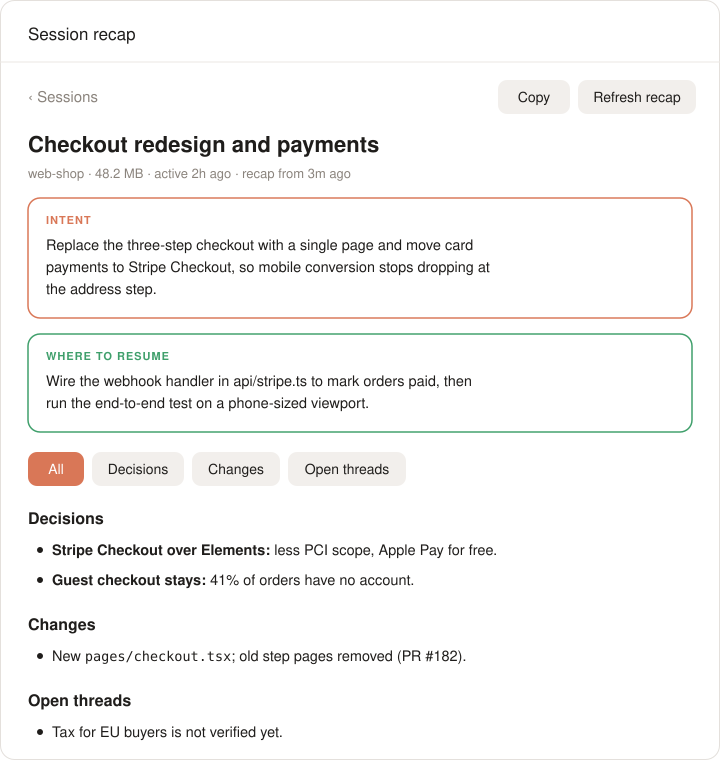

# session-recap

<p align="center"><a href="./README.md">English</a> | <a href="./README.zh-CN.md">中文</a></p>

<p align="center">

</p>

<p align="center"><strong>记住每个 AI 编程会话当初是为了什么。</strong></p>

<p align="center"><sub>核心意图 · 关键决策 · 改动 · 遗留问题 · 从哪里继续；再长的会话、哪个 agent 的会话都适用，可通过 MCP、本地查看器或插件使用</sub></p>

<p align="center">
<a href="https://github.com/BruceXcluding/session-recap/actions/workflows/ci.yml"></a>
<a href="https://github.com/BruceXcluding/session-recap/releases"></a>
<a href="./LICENSE"></a>
</p>

<p align="center">
<a href="https://claude.com/product/claude-code" title="Claude Code"></a>&nbsp;
<a href="https://github.com/openai/codex" title="Codex"><picture><source media="(prefers-color-scheme: dark)" srcset="https://api.iconify.design/simple-icons/openai.svg?color=white"></picture></a>&nbsp;
<a href="https://www.deepseek.com" title="deepseek-harness (dsh)"></a>&nbsp;
<a href="https://opencode.ai" title="OpenCode"><picture><source media="(prefers-color-scheme: dark)" srcset="https://cdn.simpleicons.org/opencode/FFFFFF"></picture></a>
</p>

---

项目越来越多，每个项目里的会话也越来越多，还常常分散在好几个 agent 里。几周之后，一个会话就是一份上百 MB、你已经记不清的记录：当初为什么开始、做了哪些决定、哪些事做了一半。

**session-recap** 会读完一个会话的全部记录，写出一份简短、结构化的回顾。可以在**任何 MCP 客户端**（Codex、Cursor、Zed、Cline、Gemini CLI、OpenCode、Claude Code……）里用，在**本地查看器**里浏览所有 agent 的会话，用**命令行**，或者通过 **Claude Code**、**dsh**、**Codex** 的原生插件使用。

<p align="center">

</p>

| 部分 | 回答的问题 |
| --- | --- |
| **Intent（意图）** | 我最终想达成什么？ |
| **Key ideas and decisions（关键思路与决策）** | 选了什么、为什么选，放弃了哪些方案？ |
| **What changed（改动）** | 文件、功能、文档、提交、PR |
| **Open threads（遗留问题）** | 还没做完、没验证或仍待回答的事 |
| **Where to resume（从哪里继续）** | 今天接着做，最合理的下一步 |

每份回顾还有一张 **Map**：工作经历的各个阶段（转向处标出）一直到"you are here"，关键决策及被放弃的方案，以及已交付、未完成、已放弃的清单。回顾使用你在该会话中主要使用的语言。

## 快速开始

```bash
npm install -g github:BruceXcluding/session-recap --allow-git=all
session-recap mcp-config            # 输出你所用客户端的 MCP 配置
session-recap serve                 # 打开本地查看器
```

然后对你的 agent 说：*"回顾一下这个会话"*、*"我在这个项目上一个会话是做什么的？"*、*"Recap this session"*。

**不需要 API key。**通过 MCP 使用时，由正在和你对话的 agent 用它自己的模型写回顾；session-recap 只负责读取和压缩记录。session-recap 自己的模型是可选的（用于命令行和查看器里的 **Write recap** 按钮）。

`--allow-git=all` 让 npm 12 可以从 GitHub 安装（npm 12 默认禁止，见 [npm v12](https://github.blog/changelog/2026-07-08-npm-install-time-security-and-gat-bypass2fa-deprecation/)），旧版 npm 也接受这个参数。session-recap 不运行任何安装脚本。

**环境要求：**Node.js 20+、`python3`（macOS 自带），读取 dsh 会话需要 `zstd` 命令或 Python 3.14+。

## 使用方式

| | 适合 | 怎么用 |
| --- | --- | --- |
| **MCP 服务器** | 任何 MCP 客户端 | `session-recap mcp-config <客户端>`，见下文 |
| **本地查看器** | 浏览所有 agent 的会话、Recap 和 Map | `session-recap serve` |
| **Claude Code 插件** | 对话旁的 Recap / Map 面板 | `/plugin install session-recap --marketplace BruceXcluding/session-recap` |
| **dsh 插件** | dsh 里的 `/recap` 和 `session_recap` 工具 | [packages/dsh](packages/dsh/README.md) |
| **Codex 插件** | 为 Codex 打包好的 MCP 服务器 | [plugins/codex](plugins/codex/README.md) |
| **命令行** | 脚本、快速查看、其他格式 | `session-recap`、`session-recap list` |

### MCP 服务器

`session-recap mcp-config <客户端>` 输出 `claude`、`codex`、`cursor`、`gemini`（以及 Qwen Code）、`opencode`、`zed`、`vscode` 或 `cline` 的配置，使用绝对路径，从程序坞启动的 IDE 也能找到。例如：

```bash
session-recap mcp-config codex >> ~/.codex/config.toml
claude mcp add --scope user session-recap -- session-recap mcp
```

工具：

| 工具 | 作用 |
| --- | --- |
| `list_sessions` | 列出所有 agent 的会话，可按标题关键词、项目文件夹或 agent 筛选 |
| `recap_session` | 当前会话（或指定会话）的回顾：会话没变就返回已保存的回顾；否则若配置了 session-recap 的模型就由它来写；否则返回压缩并去除密钥后的记录和说明，由调用它的 agent 来写 |
| `save_recap` | 保存 agent 写好的回顾，下次直接复用，会话继续后只更新新增部分 |

`recap_session` 还支持 `format`：用 `standup`、`handoff` 或 `pr` 代替回顾。

### 本地查看器

`session-recap serve` 会打开 `http://127.0.0.1:4711`：按项目文件夹列出所有 agent 的会话，按时间分组、可按 agent 筛选；每个会话的 Recap 和 Map；配置了模型时还有 **Write recap** 和 **Update recap**。Claude Code 插件、命令行和 MCP 客户端写的回顾在这里都能看到。它只在本机回环地址上响应，只对它打开的那个浏览器标签页开放。

### Claude Code 插件

`/session-recap` 回顾当前会话；`/session-recap browse` 列出项目和会话；`/session-recap <名称>` 按名称打开项目或会话。面板有 Recap 和 Map，使用会话自身的模型（或在 **Model** 里选择的模型），默认先显示 Claude Code 的会话，点 **All agents** 即可看全部。

### 命令行

| 命令 | 作用 |
| --- | --- |
| `session-recap [关键词]` | 回顾标题包含这些词的会话；不加词则回顾当前文件夹最新的会话 |
| `session-recap list [关键词]` | 列出会话（调用它的 agent 的；加 `--all` 显示所有 agent） |
| `session-recap --format standup` | 改为站会纪要（还有 `handoff`、`pr`） |
| `session-recap --dry-run` | 显示将发送的内容大小和去除的密钥数量，不调用模型 |
| `session-recap models` | 列出服务提供的模型 |
| `session-recap config set model <id>` | 保存设置（`partModel`、`api`、`baseUrl`；key 用 `config set apiKey -` 从 stdin 读取） |

命令行自己的模型：`SESSION_RECAP_API`（`anthropic` 或 `openai`）、`SESSION_RECAP_BASE_URL`、`SESSION_RECAP_API_KEY`、`SESSION_RECAP_MODEL`，或 `ANTHROPIC_*`、`DEEPSEEK_API_KEY`、`OPENAI_API_KEY`。

## 支持的 agent

| Agent | 会话读取位置 |
| --- | --- |
| Claude Code | `~/.claude/projects/` |
| Codex | `~/.codex/sessions/`、`archived_sessions/`（自动评审线程不列出） |
| dsh（deepseek-harness） | `~/.dsh/sessions/`（zstd 压缩；子 agent 会话不列出） |
| OpenCode | `~/.local/share/opencode/opencode.db` |

想支持其他 agent？[添加一个 agent](docs/adding-an-agent.md) 只需一个读取器和一个测试，或者[提需求](https://github.com/BruceXcluding/session-recap/issues/new?template=new_agent.yml)。

## 隐私

- **本地读取。**会话在你的电脑上读取，文本只会随回顾所需的那次模型调用离开本机：你的 agent 的模型（MCP、插件），或你配置的模型（命令行、查看器）。没有遥测。
- **先去除密钥。**key、令牌、私钥、URL 里的账号密码，以及 `PASSWORD=…` 这类赋值，在任何文本发给模型之前都会被替换成 `[REDACTED:<类型>]`。`--dry-run` 会显示去除了多少。这是基于模式匹配的，无法覆盖所有格式，详见 [SECURITY.md](SECURITY.md)。
- **发送的内容**是压缩后的记录：你的提问、每轮最后的回复、提交和 PR、编辑过的文件。工具输出和中间回复不会发送。

## Token 用量

列出会话从不调用模型。在一个真实的 179 MB Claude Code 会话（220 条提问）上，首次回顾发送约 **19.5 万字符（约 9.6 万 token）**；会话继续后，更新只读取新增的提问。长会话按 ≤75k 字符分段压缩，每段笔记都有缓存，还可以用更便宜的模型压缩分段（`partModel`）。

## 工作原理

```
保存的会话（Claude Code · Codex · dsh · OpenCode）
        │
hooks/digest.py      每个 agent 一个读取器 → 按轮整理（提问、操作、最后回复、编辑）→ 去除密钥
        │
core/recap.mjs       分段 → 笔记（并行、有缓存）→ 一次调用写出回顾和 Map，或更新已有回顾
        │
MCP 服务器 · 查看器 · 命令行 · Claude Code 面板 · dsh 工具和 /recap      （共用缓存：~/.cache/session-recap）
```

输出格式有版本号：想自己做查看器或导出工具，见 [docs/data-format.md](docs/data-format.md) 和 [`schema/recap-v1.schema.json`](schema/recap-v1.schema.json)。

## 参与贡献

欢迎贡献新的 agent、回顾格式、翻译和查看器。从 [CONTRIBUTING.md](CONTRIBUTING.md) 开始；[添加一个 agent](docs/adding-an-agent.md) 和添加一种格式（在 [`core/formats.mjs`](core/formats.mjs) 里加一项）是最容易上手的贡献。

## 许可证

[MIT](./LICENSE)
